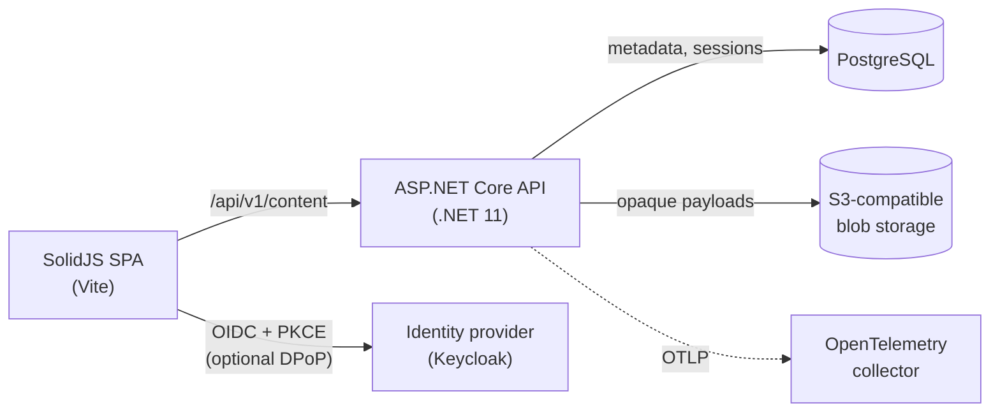

# ShareIt

Share text and files together behind one short link. No account is required to create a link;
each package can expire on its own, allow a limited number of opens, and be encrypted
in the browser by default (the passphrase can be switched off).

This is a personal hobby project: one instance, one maintainer. The API, the database schema and the
storage format carry no compatibility guarantees — breaking changes land in place, updating every
caller in the same change rather than keeping a migration or deprecation path around. See
[`AGENTS.md`](AGENTS.md#project-constraints).

## What it does

- **One link for text and files.** Paste text, drop files, or both, and get a single share link.
- **Optional access codes.** Pick code mode and get a six-character code such as `ABC-234`, made of
  a three-character server locator and a three-character secret generated in the browser. It is
  single-use, expires after ten minutes, and never becomes a link; only the locator reaches the
  API.
- **Guest or signed in.** Guests need no account or stored identity and can create links.
  Signing in (OIDC) additionally lets owners list and delete their links.
- **Expiry and access limits.** Every package has a lifetime and a maximum number of opens, with
  larger limits for authenticated users.
- **Client-side encryption by default.** One generated passphrase per package (switch it off for a
  plain link). Content, filenames and MIME types
  are sealed with WebCrypto (AES-256-GCM, PBKDF2-derived key); the API only ever stores and serves
  opaque bytes and an unlock verifier.
- **Expiring access sessions.** Opening a package returns a short-lived, package-wide session used
  for re-fetches and downloads. It is kept in `sessionStorage`, never in a URL.

## Architecture



- `frontend/` — SolidJS + Vite + TypeScript SPA with Tailwind CSS. Handles the composer, the share
  gate, owner link management, and all client-side encryption.
- `backend/kroet.ShareIt.Api` — ASP.NET Core minimal API. Stores package/item metadata in
  PostgreSQL, payloads in S3-compatible storage, and enforces identity, limits, rate limits and
  access sessions.
- `backend/kroet.ShareIt.AuthTwin` — a local OIDC stand-in for Keycloak used in development and
  tests. It implements only the endpoints this app consumes.
- `apphost.cs` — .NET Aspire orchestration that starts the API, AuthTwin, frontend, PostgreSQL and
  RustFS together.

## Run it locally

Requirements: [.NET 11 SDK](https://dotnet.microsoft.com/) (pinned in `global.json`), the Aspire CLI
(`dotnet tool install -g Aspire.Cli`), a running Docker daemon, Node.js (pinned in
`.node-version`), and `pnpm`.

```bash
dotnet run apphost.cs
```

This starts everything with fixed ports: frontend on <http://localhost:3001>, API on
<http://localhost:5155>, and the AuthTwin on <http://localhost:8190>. `aspire run` works too with
Aspire CLI 17 or later.

### Run services individually

In three terminals (the all-in-one orchestration above is preferred):

```bash
dotnet run --project backend/kroet.ShareIt.AuthTwin   # OIDC stand-in, port 8190
dotnet run --project backend/kroet.ShareIt.Api        # API, port 5155
cd frontend && pnpm install && pnpm dev               # SPA, port 3001
```

Without the AppHost, the API uses its in-memory development stores unless you point
`ContentStorage` and `BlobStorage` at PostgreSQL and S3. The `keycloak` launch profile switches the
API from the AuthTwin to the real Keycloak configured in `appsettings.Development.json`.

## Tests

```bash
# backend: unit and endpoint/integration tests (integration tests need Docker)
dotnet test backend/kroet.ShareIt.slnx

# frontend: unit + component tests, then the full lint/type/format/knip gate
cd frontend && pnpm test
cd frontend && pnpm verify
```

## Configuration

- **API:** `backend/kroet.ShareIt.Api/appsettings.json` (upload limits, rate limits, access session
  lifetime, auth, cleanup) plus standard environment variable overrides. OpenTelemetry is
  configured through the usual `OTEL_EXPORTER_OTLP_*` variables.
- **CORS:** Production fails closed when no origins are configured. Set `Cors:AllowedOrigins`
  (for example `Cors__AllowedOrigins__0=https://app.example`) in any deployment where the SPA and
  API are not served from the same origin.
- **Frontend:** runtime configuration through `/env.js`, resolved as `window.env` → `VITE_*` →
  defaults. The Docker image substitutes container environment variables at startup, so one build
  serves every environment.

## Documentation

| Document | Contents |
| --- | --- |
| [`docs/upload-download.md`](docs/upload-download.md) | Package lifecycle, endpoints, identity, limits and error behavior |
| [`docs/crypto.md`](docs/crypto.md) | Key schedule, sealed frame format, metadata and unlock proof |
| [`docs/observability.md`](docs/observability.md) | OTLP setup, metrics, traces and logs |
| [`frontend/docs/runtime-config.md`](frontend/docs/runtime-config.md) | Runtime configuration and deployment pattern |
| [`backend/kroet.ShareIt.AuthTwin/README.md`](backend/kroet.ShareIt.AuthTwin/README.md) | Development auth twin and its control plane |

## Deployment

The release workflow builds and pushes two images to GHCR: `shareit-api` and `shareit-frontend`.
The frontend image is an unprivileged nginx serving the static SPA and generating `env.js` from
container environment variables at startup; the API image is a chiseled ASP.NET runtime image.

## License

[MIT](LICENSE)
