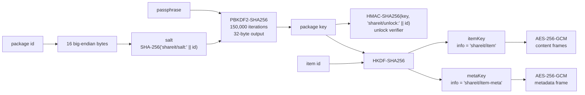

# Client-side encryption

A package can be protected by one passphrase. Sealing and opening happen in the browser with
WebCrypto; the API receives an unlock verifier, an opaque metadata blob and opaque payload bytes.
Unprotected packages use raw payload bytes and plaintext JSON metadata.

| Value | Lives in |
| --- | --- |
| Passphrase | the `#s=` link fragment or the gate input; never sent to the API |
| Package key | browser memory only |
| Unlock verifier | `content_packages.unlock_verifier` and the `X-Unlock-Proof` header |
| Item content keys and metadata keys | derived on demand from the package key |
| Sealed content | S3-compatible blob storage |
| Sealed or plaintext metadata | `contents.meta` as base64url text |

## Identifiers and links

The client generates the package id and every item id as UUIDs. Keys and AAD use one normalized
form: lowercase, hyphenated UUID. `normalizeId` in `frontend/src/shared/crypto/ids.ts` is the only
place that formats an id; `idBytes` returns the 16 UUID bytes in RFC 4122 big-endian order.

```
plain     …/s/{packageId}
combined  …/s/{packageId}#s={passphrase}
```

An access code is not a link. The six characters the sender sees (`ABC-234`) are split into the
server locator (`ABC`) and the client secret (`234`). Only the locator is stored and resolved to the
package id; the secret never leaves the browser. It is used directly as the passphrase in the
existing schedule, so the salt still comes from the 128-bit package id and an attacker who resolves
the public locator learns nothing about the key.

```
user code   ABC-234
locator     ABC        → POST /package/code/resolve → packageId
secret      234        → deriveKeyBits("234", salt(packageId))
passphrase  same as the secret; never sent to the server
```

Because the salt is the globally unique package id, the three-character secret has the same secret
entropy as it would inside the full code. Every guess must be tested online against the package's
`X-Unlock-Proof`, and the server burns a code-mode package after five failures. Resolution returns
only the package id; no ciphertext or metadata is exposed before a valid proof. The browser replaces
the URL with `…/s/{packageId}` and passes the secret in router state, never in the URL. `normalizeId`
remains the only place that formats the canonical id. See [upload-download.md](upload-download.md)
for the code-mode guardrails (10-minute TTL, single use).

The fragment keeps the passphrase out of server logs and `Referer` headers. The salt is derived
from the package id, so the plain link contains everything needed to derive the key when the
passphrase is known. After a successful unlock the client removes `#s=` with
`history.replaceState` and keeps the key in memory only.

## Salt and key schedule

For a protected package, the client derives the verifier before it makes the open request, so the
PBKDF2 salt is computed from the package id:

```
salt = SHA-256( "shareit/salt:" || packageId[16 bytes, big-endian] )
```

The salt is public and unique per package. The PBKDF2 iteration count is a client constant; it is
not stored on the package or in the payload.



```
key        = PBKDF2-SHA256(passphrase, salt, 150_000 iterations, dkLen = 32)
verifier   = HMAC-SHA256(key, "shareit/unlock:" || normalizedPackageId)
itemKey(i) = HKDF-SHA256(key, salt = idBytes(i), info = "shareit/item")      -> AES-256-GCM
metaKey(i) = HKDF-SHA256(key, salt = idBytes(i), info = "shareit/item-meta") -> AES-256-GCM
```

The verifier is 32 bytes, base64url-encoded for storage and transport. The API compares it in
constant time; it never receives the passphrase or the package key. Anyone who has the verifier
can open the package without knowing the passphrase, so the value is treated as a secret and is
never logged.

## Frame container

Content, text and metadata all use one container: the `SIE3` magic followed by frames.

```
sealed = "SIE3" | frame 0 | frame 1 | …

frame  = magic             4 bytes  ("SIE3")
       | chunkIndex        u32 BE   4 bytes
       | flags             u8       1 byte   (bit 0 = isFinal)
       | ciphertextLength  u32 BE   4 bytes
       | ciphertext        n bytes
       | GCM tag           16 bytes
```

- The plaintext frame size is at most 4 MiB. Every frame has 29 bytes of overhead: 13 header bytes
  and the 16-byte GCM tag.
- Small payloads are one final frame (`chunkIndex = 0`, `isFinal = 1`). An empty payload is also
  one final frame, so a sealed blob is never zero bytes.
- `ciphertextLength` is the plaintext length of the frame.
- AES-256-GCM uses a derived 12-byte IV:
  `SHA-256("shareit/frame-iv:" || chunkIndex u32 BE)[0..12]`. The frame key is unique per
  `(packageId, itemId, role)`, and sealing the same plaintext with the same key and AAD produces
  identical frames.
- Content is sealed slice-by-slice with `file.slice(...)`; a whole-file plaintext buffer is never
  allocated. A single frame's plaintext is held while it is encrypted or verified.
- The streaming reader accepts arbitrary input chunk boundaries, verifies each frame's GCM tag
  before emitting its plaintext, and rejects a bad magic, invalid flags, an oversized frame, an
  out-of-sequence chunk index, a truncated stream and bytes after the final frame.
- The client retains a package key only for protected packages. With a key, framed ciphertext is
  required and a missing magic is an integrity error; without a key, payload bytes are used as-is.

### AAD

Every frame's GCM tag authenticates this AAD; the AAD itself is not stored:

```
aad(packageId, itemId, role, chunkIndex, isFinal) =
  utf8("shareit/frame:1:" || normalizedPackageId || ":" || normalizedItemId || ":"
       || role || ":" || chunkIndex || ":" || (isFinal ? 1 : 0))

role = "item" | "meta"
```

Both sides reconstruct the AAD from the package id, the item id and the frame position. Role,
chunk index and final flag bind a frame to its place: an item frame cannot be opened as metadata,
a reordered or duplicated chunk fails, and a non-final frame cannot be presented as a complete
item.

## Per-item metadata

Each item carries `{ name, mime }` as UTF-8 JSON. `name` is `null` for a text block; `mime` is the
real MIME type (for example `application/pdf`), not the transport type.

```
meta = sealed frame( JSON { name, mime } )   when the package is protected
     = plaintext JSON { name, mime }         when the package is not protected
```

Protected metadata is one final frame sealed with `metaKey(itemId)` and the `meta` role. It travels
as base64url in the `X-Content-Meta` upload header, is stored verbatim in `contents.meta` and is
returned verbatim in the package response. The server validates base64url and caps the decoded blob
at 4 KiB; it never parses the JSON. The item row also stores the clear `kind` and `size` because
the server needs them for limits, response metadata and metrics; the ciphertext length reveals the
payload size anyway.

The share page decodes metadata per item with the package key. An invalid or missing blob falls
back to a generated item name. With a key, plaintext metadata is an integrity error; without a
key, framed metadata is an integrity error.

## Unlock proof

A protected package has a verifier; an unprotected package has `unlock_verifier = NULL`.

```
GET /api/v1/content/package/{packageId}
X-Unlock-Proof: <base64url(verifier)>
X-Access-Session: <opaque token>          # optional, reuses an existing session
```

1. The client parses `#s=` when present and derives the salt, key and verifier before the request.
2. A plain link renders the gate and makes no request until the visitor submits it. An empty
   submission sends no proof; this is how an unprotected package opens without an extra marker in
   the link.
3. The API loads the package shell, checks expiry, then compares the proof in constant time. A
   missing or wrong proof returns `401` without reading item metadata or consuming an access.
4. After a `200`, the client keeps the key only when the response says `IsProtected`; the server's
   flag decides whether framed bytes are expected. The fragment is removed and the returned access
   session is stored for the package.

The full open and download sequence, including session claiming and item downloads, is in
[upload-download.md](upload-download.md).

## Server-visible data

The API can observe the package id, creator, timestamps, expiry, access counters, item count,
per-item kind and stored size, the verifier and each opaque metadata blob. It also sees the
ciphertext length, which reveals the plaintext length within 29 bytes per 4 MiB frame, and the
metadata blob length, which reveals the name and MIME type length. It cannot read the passphrase,
the package key, item names, real MIME types or content.

Offline guessing against the verifier or ciphertext is possible; the passphrase is the only bound
on its cost. The verifier is a stable bearer proof, so it must not be logged or cached by
intermediaries.

## Code map

| File | Responsibility |
| --- | --- |
| `frontend/src/shared/crypto/ids.ts` | UUID normalization and id bytes |
| `frontend/src/shared/crypto/keys.ts` | Salt, PBKDF2 key, verifier, HKDF item and metadata keys, frame AAD |
| `frontend/src/shared/crypto/framed.ts` | `SIE3` sealing, file encryption, buffered opening and streaming decryption |
| `frontend/src/shared/crypto/meta.ts` | `{ name, mime }` encoding, parsing and sealing |
| `frontend/src/shared/crypto/item-content.ts` | Opens one downloaded item with or without a package key |
| `frontend/src/features/composer/use-composer.ts` | Derives the key and verifier, seals items, uploads them |
| `frontend/src/features/share/use-share.ts` | Derives the key from the link or gate, sends the proof, decodes metadata |
| `frontend/src/features/share/read-item.ts`, `save-file.ts` | Downloads items and streams decrypted file content to disk |
