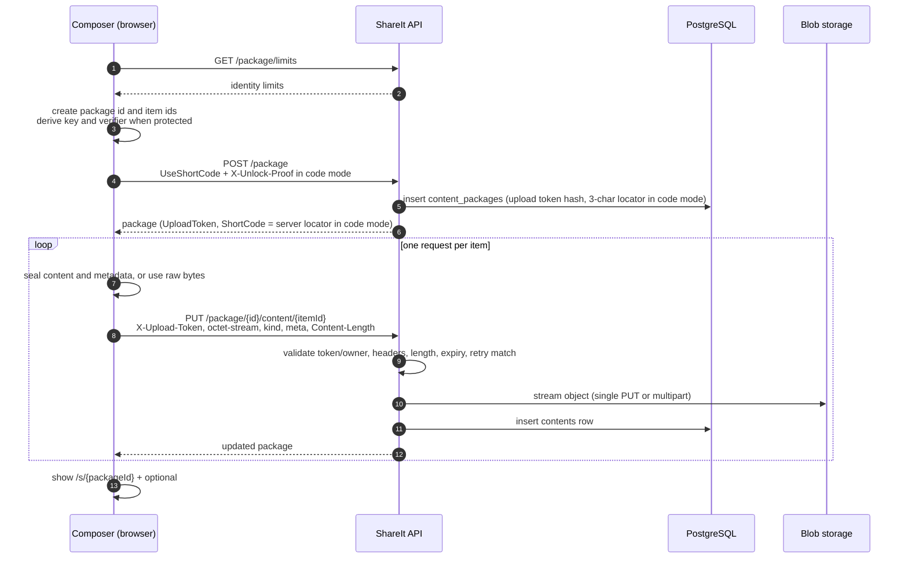
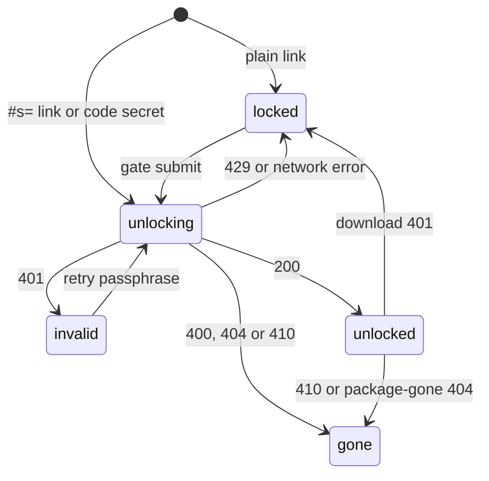
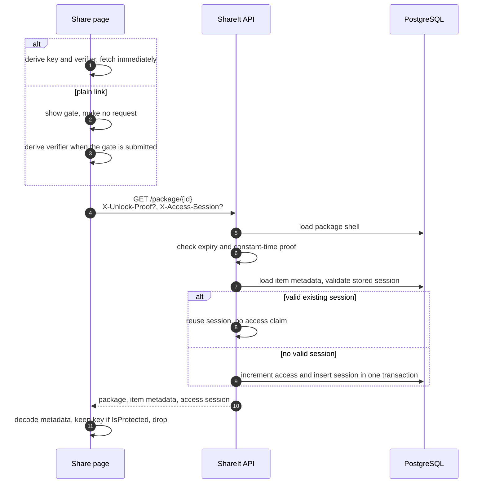
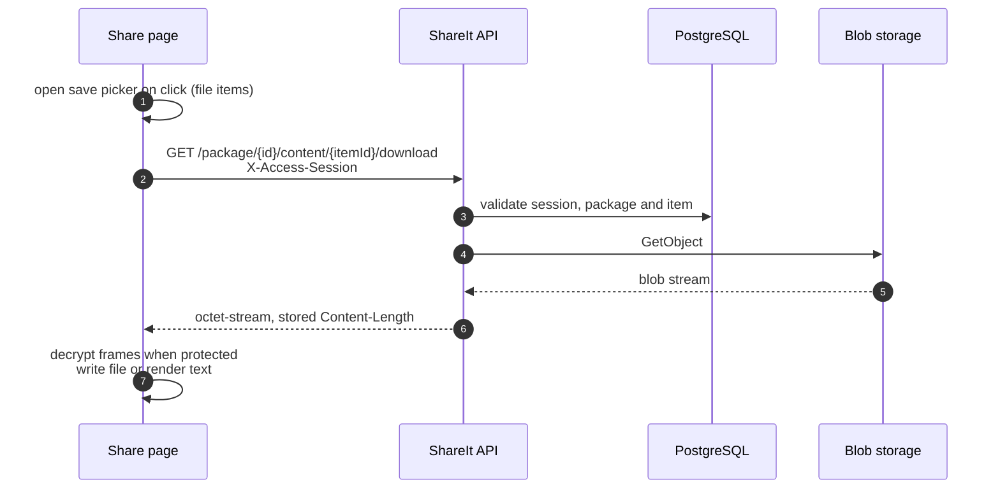

# Upload and download flow

A package is created by a browser, filled one item at a time, and later opened and downloaded by a
recipient. The API stores package and item metadata in PostgreSQL and payload bytes in S3-compatible
blob storage. Item bytes are sealed in the browser when the package is protected; the API treats
them as opaque. See [crypto.md](crypto.md) for the key schedule, metadata format and frame layout.

## Endpoints

All paths are under `/api/v1/content`.

| Method | Path | Purpose |
| --- | --- | --- |
| `GET` | `/package/limits` | Per-identity upload and package limits |
| `POST` | `/package` | Create an empty package, optionally in code mode |
| `POST` | `/package/code/resolve` | Resolve the three-character locator of an access code to the canonical package id |
| `PUT` | `/package/{packageId}/content/{contentId}` | Upload one item as a raw binary body |
| `GET` | `/package/{packageId}` | Open a package: metadata, items and an access session |
| `GET` | `/package/{packageId}/content/{contentId}/download` | Download one item with the access session |
| `GET` | `/packages` | List the authenticated owner's packages |
| `DELETE` | `/packages/{packageId}` | Delete an owned package |

`GET /packages` and `DELETE /packages/{packageId}` require an authenticated user. Guests can
create packages and upload items.

## Identity

There is no client-generated guest ID. The API resolves a caller to one
nullable `user_id`:

- an OIDC bearer token (with a DPoP proof when DPoP is required) supplies the
  verified `sub` claim;
- an unauthenticated request is a guest with `user_id = null`.

Guests can create packages and upload items, but only authenticated users can
list or delete packages. A package stores its owner as `content_packages.user_id`
(null for guests), and an access session stores the opener in
`access_sessions.user_id` (also null for guests). Re-fetches and downloads must
present a session bound to the same nullable `user_id`, so a guest can never use
a signed-in user's session and vice versa.

## Upload

### Capability tokens

Uploads and reads use two symmetric capability tokens:

| Token | Header | Minted by | Stored by the server | Used for |
| --- | --- | --- | --- | --- |
| Upload token | `X-Upload-Token` | `POST /package` | hex SHA-256 in `content_packages.upload_token_hash` | item uploads and idempotent create retries |
| Access session | `X-Access-Session` | `GET /package/{id}` | hex SHA-256 in `access_sessions.token_hash` | package re-fetches and downloads |

Both are 32 random bytes encoded as exactly 43 base64url characters (`A-Z`,
`a-z`, `0-9`, `-`, `_`), and are returned only in the response that mints them,
with `Cache-Control: no-store`. Every stored hash comes from a token of that
shape, so a value of another length or with padding or standard-alphabet
characters cannot match one: it is rejected before it is hashed, as a `400`
when an upload presents a malformed `X-Upload-Token`, and as simply an invalid
session when a read presents a malformed `X-Access-Session` (a `401` on
download, a fresh access claim on open). Upload-token checks compare the
stored hash with the presented token's hash in constant time; access sessions
are looked up by their hash. The upload token lives only in composer memory
until the upload finishes; the access session lives in per-tab `sessionStorage`
for 15 minutes.

### Browser preparation

The composer builds one text item when the trimmed text is non-empty and one item per file. It
generates the package UUID and one UUID per item before any network call. A passphrase is optional;
when one is set, or when code mode is selected, the client derives the package key and unlock
verifier from the package id.

```json
POST /api/v1/content/package
{
  "Id": "0192f3a0-1111-7000-8000-000000000000",
  "UnlockVerifier": "base64url HMAC or null",
  "UseShortCode": false,
  "TimeToLiveHours": 168,
  "MaxAccessCount": 3
}
```

- `Id` is required and non-empty.
- `UnlockVerifier` is base64url of exactly 32 bytes when the package is protected, otherwise `null`.
- `UseShortCode` opts the package into access by code (see below).
- `TimeToLiveHours` is required and must be within the identity's maximum lifetime.
- `MaxAccessCount` must be positive and within the identity's maximum; guests must set it.
- Repeating the create call with the same id, the same owner and the returned `UploadToken` returns
  the existing package with `200`; a new package returns `201`. Without the token, with a token that
  does not match, or with a different owner, an existing id returns `409` — the token on create is
  optional and only consulted when reusing an id, so a malformed one is simply a non-match rather
  than a `400`. A code-mode retry must also use the same `UseShortCode` value and `UnlockVerifier`,
  otherwise the API returns `409`. An expired package with a valid token returns `410`.
- The response is a `ContentPackageOwnerResponse`; its `UploadToken` is the only copy of the token
  the server will ever return. In code mode its `ShortCode` is the three-character server locator;
  for a regular package it is `null`. The open-package response never exposes either.

### Access by code

A code is an opt-in, single-use alternative for devices where a link or a passphrase cannot be
transferred. The six characters the sender sees (`ABC-234`) are split in two:

- `ABC` — the server locator. In code mode it is generated at package creation, stored in
  `content_packages.short_code` and resolved to the package UUID.
- `234` — the client secret. It is generated in the sender's browser, never sent to or stored by the
  server, and is the passphrase of the package key schedule.

`POST /package` with `UseShortCode: true` requires a matching `X-Unlock-Proof` header because the
client already knows the secret before creation. The server:

- requires `UnlockVerifier`, so a code-mode package is always encrypted;
- clamps `MaxAccessCount` to `1` and the lifetime to 10 minutes, for guests and authenticated users
  alike;
- allocates a unique three-character locator from the unambiguous 31-character alphabet
  `23456789ABCDEFGHJKMNPQRSTUVWXYZ`, retrying collisions up to ten times and returning `503` when
  allocation is exhausted;
- returns the locator as `ShortCode`. Uploads then proceed through the normal pipeline; the locator
  never enters the key schedule, frame AAD, access sessions or download paths.

Resolution takes only the three-character locator, in the body:

```http
POST /api/v1/content/package/code/resolve
Content-Type: application/json

{ "Code": "ABC" }
```

- The locator is case-insensitive; hyphens and whitespace are ignored.
- `200` returns only `{ "PackageId": "…" }` and sets `Cache-Control: no-store`. Unknown, expired and
  exhausted packages return `404`.
- The lookup never claims an access. The client then opens the package through the canonical UUID,
  with `X-Unlock-Proof` derived from the client secret.
- A wrong `X-Unlock-Proof` on a code-mode package increments `failed_unlock_attempts`. The fifth
  miss invalidates the package atomically, so it can no longer be resolved or opened.
- Lookups are rate-limited per remote IP (IPv6 clients share a /64 budget); there is no
  process-wide lookup budget. Tune the per-IP limit with
  `RateLimitSettings:ShortCodeLookupPermitLimit` and
  `RateLimitSettings:ShortCodeLookupWindowMinutes`.
- The locator travels in the body, so it does not appear in access logs, browser history or
  referrers.
- Lookup and allocation outcomes are emitted as bounded metrics; sustained `not_found` values are
  the alerting signal for enumeration.

Locators are recycled after cleanup deletes a package: three characters leave a small space, so a
code is unique among active packages, not forever. The owner list only carries `HasShortCode`,
because the server cannot reconstruct the full code without the client secret. The creating tab
keeps the full code in `sessionStorage` until it expires, so that tab's links list can offer
"copy code"; other tabs or devices only see `HasShortCode`.

Final decisions for code access:

- Resolution is `POST /package/code/resolve` with the locator in the body, never in the URL.
- The share route is UUID-only; codes never become links.
- Only the per-IP lookup limit exists; there is no process-wide budget.
- Locators are recycled after package deletion.

The share link is always `…/s/{uuid}`. A code is entered manually on the home page, the browser
resolves the locator, and the client secret is handed to the UUID route in router state (never in
the URL) so the share page derives the key and opens the package without a password gate.

### Per-item upload

Each item is one `PUT` with a raw binary body. The browser streams a `File`/`Blob` directly, so the
client never reads an unencrypted file into JavaScript memory. Protected items are sealed
slice-by-slice into 4 MiB frames first.

```http
PUT /api/v1/content/package/{packageId}/content/{contentId}
Content-Type: application/octet-stream
Content-Length: <stored byte length>
X-Upload-Token: <token returned by POST /package>
X-Content-Kind: text | file
X-Content-Meta: <base64url metadata blob>
```

The server validates in this order, before reading the body:

1. a non-empty `X-Upload-Token` of the shape described above (`400` when it is missing or malformed);
2. content id;
3. `Content-Type: application/octet-stream`;
4. `X-Content-Kind` (`text` or `file`) and base64url `X-Content-Meta` (at most 4 KiB decoded);
5. a required, positive `Content-Length` within the per-identity file limit;
6. package existence (`404`), then the nullable `user_id` and upload token (a mismatch is `403`) and
   expiry (`410`);
7. an existing item with the same id: same package, kind, size and metadata returns `200`
   idempotently, anything else is `409`;
8. the package item count against `MaxItemsPerPackage`.

The payload then streams through `DeclaredLengthStream`, which counts the bytes actually read,
stops forwarding at the first byte above the declared length, and rejects a body that ends early.
A mismatch returns `400`; a body above the identity's absolute file limit returns `413`. On any
failure, the partial blob is removed.

The blob store uses one of two write paths:

- bodies up to 1 MiB are buffered once and stored with a single S3 `PutObject`;
- larger bodies use an S3 multipart upload with one reusable 8 MiB buffer; an interrupted
  multipart upload is aborted.

The object gets a random UUID key, `application/octet-stream` as its content type, and object
metadata containing the content id. After the blob is stored, the API inserts the `contents` row
with the item id, package id, kind, stored size, opaque `meta` and blob key. If that insert fails,
the newly uploaded blob is deleted.

Sealing is deterministic and ids are stable, so retrying the same item with the same kind, size and
metadata is idempotent. The composer keeps the package id, item ids and upload token in its partial
state; the token is dropped from memory when the upload completes. The result screen is shown only
after every item succeeds. For a regular package it displays the canonical `/s/{packageId}` link
and, when protected, the `#s=` link together with the passphrase. A code-mode package shows only the
six-character code (`ABC-234`), never a link or a separate passphrase.



## Open

### Share page states

The share page is a small state machine built in `frontend/src/features/share/use-share.ts`.



- A link with `#s=` derives the key and verifier and fetches immediately; the page shows a
  skeleton, not the gate.
- The home-page code form normalizes the six characters, resolves the locator, and navigates to
  `/s/{packageId}` with the client secret in router state. The share page takes the same immediate
  unlock path; the secret never appears in the URL or in `sessionStorage`.
- A plain link shows the gate and makes no request until the visitor submits. Because protection
  is not discoverable from the link, an empty submission fetches without a proof. Unprotected
  packages open; protected packages answer `401` and ask for the passphrase.
- The gate contains no package data: no id, item count, names, expiry or counters are rendered
  before the open succeeds.
- On success the client stores the returned access session in `sessionStorage`, decodes item
  metadata, keeps the key only when `Package.IsProtected` is true, and removes `#s=` from the
  address bar.
- A `401` from a later download clears the stored session and returns to the gate with an expired
  session message. A `410` or a package-gone `404` clears it and shows the gone state. Other
  download errors stay on the item and can be retried.

### Open request and server order

```http
GET /api/v1/content/package/{packageId}
X-Unlock-Proof: <base64url verifier>     # protected packages only
X-Access-Session: <opaque token>         # optional, when this tab already has one
```

The API processes the open in this order:

1. Load the package shell: id, verifier, expiry and counters. No items and no blob reads.
2. Missing package: `404`. Expired package: `410`.
3. Protected package with a missing or wrong proof: `401`, no item data and no access claim. On a
   code-mode package each miss increments `failed_unlock_attempts`; the fifth miss sets the
   package's expiry to now, so it resolves and opens as gone from then on.
4. Load item metadata. An empty package returns `410` without claiming an access.
5. Validate `X-Access-Session` when present. A valid session for the same nullable `user_id` skips
   the claim and is returned again; a session bound to a different identity is treated as invalid.
6. If no valid session exists and the access limit is reached, return `410`.
7. Build the item list in creation order using only metadata: `Id`, `Kind`, `Size` and `Meta`.
8. Claim one access and insert the access session in the same transaction. Concurrent claims
   serialize on the package row and cannot exceed the limit.
9. Return the package, items and session with `Cache-Control: no-store`.

A successful open therefore performs zero blob reads. The response session is an opaque token
made from 32 random bytes; the server stores only its SHA-256 hash. The client keeps the token in
`sessionStorage`, never in a URL. The default lifetime is 15 minutes and it is not renewed
automatically. It authorizes repeated and parallel downloads without another access claim until it
expires. An open with a valid session does not consume another access.



## Download

Every item download goes through the package's access session. Nothing is inlined in the open
response, and the item's `kind` only decides how the share page renders it (text block or file row).

```http
GET /api/v1/content/package/{packageId}/content/{contentId}/download
X-Access-Session: <opaque token>
```

The API requires `X-Access-Session` (missing session `400`) and validates it against the package
and the caller's nullable `user_id` (a mismatch is `401`). An invalid or expired session returns
`401`, unless the package itself is missing (`404`, problem type
`urn:shareit:problem:package-gone`) or expired (`410`). The API then checks that the item belongs to
the package and that the package has not expired. It opens the stored blob and streams it with
`Content-Type: application/octet-stream`, the stored byte length as `Content-Length` and
`Cache-Control: no-store`. The response is copied in 64 KiB chunks and stops when the client
disconnects. A missing blob returns `404`.

The client treats the bytes differently by kind:

- **Text block**: fetched into a `Blob`, opened with the item key when protected, then decoded as
  UTF-8 and rendered. Text items load independently and do not block each other.
- **File row**: downloaded on click. `saveResponseStream` opens a save destination with
  `showSaveFilePicker` first (the picker must run in the click handler), then requests the body.
  The response body pipes through the frame decryptor when protected and into a
  `FileSystemWritableFileStream`. Without a writable destination, plaintext chunks are collected
  into a `Blob` and saved through an object URL. A canceled picker is not an error.
- A frame's plaintext is emitted only after its GCM tag verifies. A tampered, truncated,
  reordered or trailing-byte stream fails without producing the unverified bytes.

Downloads never consume the session, so retries and parallel downloads reuse the same grant. A
re-fetch of the package with a valid session does not claim another access.



## Limits and errors

Defaults from `appsettings.json`; all values are configurable.

| Setting | Guest | Authenticated |
| --- | --- | --- |
| Per-item upload limit | 25 MB | 100 MB |
| Maximum package lifetime | 6 hours | 720 hours (30 days) |
| Maximum access count | 1 | 10 |
| Maximum items per package | 100 | 100 |
| Maximum request body | 512 MB | 512 MB |

Package reads are limited to 20 per 15 minutes per `(package id, remote IP)`. Downloads are
limited to 120 per minute per remote IP, and uploads to 120 per minute per remote IP. A rejected
request returns `429` with `Retry-After`.

| Status | Meaning in the transfer flow |
| --- | --- |
| `400` | Missing upload token/access session, malformed metadata, missing/empty `Content-Length`, or a body that ends early |
| `401` | Missing/wrong unlock proof, or an invalid/expired access session |
| `403` | The caller's `user_id` or upload token does not match the package |
| `404` | Unknown package/item, or a package-gone problem on download |
| `409` | A package or item id is already in use with different content |
| `410` | Package expired, exhausted, or empty |
| `413` | Body above the per-identity upload limit |
| `415` | Upload body is not `application/octet-stream` |
| `429` | A package-read, download or upload rate limit was hit |

## Storage and lifecycle

| Data | Location |
| --- | --- |
| Package metadata, verifier, expiry, counters and upload-token hash | `content_packages` |
| Item kind, size, opaque `meta` and blob key | `contents` |
| Access sessions (token hash, nullable user binding, expiry) | `access_sessions` |
| Blob deletion queue | `blob_deletion_jobs` |
| Payload bytes | S3 object under a random UUID key |

Every package has a required `expires_at`, so an abandoned upload is swept by cleanup. Owner
deletion and cleanup delete PostgreSQL metadata and queue the package's blob keys in the same
transaction; the background cleanup service drains the queue and retries failures. A missing blob
counts as deleted. Cleanup runs every five minutes by default, so after an owner deletion the
metadata disappears immediately while its blobs remain until the next pass. Expired packages are
deleted on the next cleanup pass. Packages whose access limit is reached are retained for
`ExhaustedPackageRetentionMinutes` (30 minutes by default, at least the access-session lifetime)
after their last access so the final session can still download, then they are deleted. Cleanup
also removes expired access sessions.

The owner's links list is keyset-paginated newest-first and contains no item names; only
timestamps, sizes, counters, expiry and protection state.

## Code map

| File | Responsibility |
| --- | --- |
| `frontend/src/features/composer/use-composer.ts` | Ids, key/verifier, sealing, upload progress, retry state |
| `frontend/src/shared/api/content.ts` | Create, raw `PUT` upload, open, download and list wrappers |
| `frontend/src/features/share/use-share.ts` | Gate, fragment handling, proof/session open, metadata decoding |
| `frontend/src/features/share/read-item.ts` | Buffered item download and package/session failure routing |
| `frontend/src/features/share/save-file.ts` | Streaming save through the picker, decryptor and Blob fallback |
| `frontend/src/features/share/access-session.ts` | `sessionStorage` access-session storage |
| `backend/kroet.ShareIt.Api/Endpoints/ContentEndpoints.cs` | Create, upload, open and download endpoints |
| `backend/kroet.ShareIt.Api/Endpoints/DeclaredLengthStream.cs` | Declared-length and upload-limit enforcement |
| `backend/kroet.ShareIt.Api/Services/Storage/StorageHandler.cs` | Blob/metadata coordination and compensation |
| `backend/kroet.ShareIt.Api/Storage/S3/S3BlobStorageHandler.cs` | Bounded single-PUT and multipart storage |
| `backend/kroet.ShareIt.Api/Storage/AccessSessionService.cs` | Session token generation, hashing and validation |
| `backend/kroet.ShareIt.Api/Storage/OpaqueToken.cs` | Shared token creation, SHA-256 hashing and constant-time comparison |
| `backend/kroet.ShareIt.Api/Storage/Postgres/SqlContentStorageHandler.cs` | Package/item/session persistence and cleanup queries |
| `backend/kroet.ShareIt.Api/Services/Cleanup/CleanupService.cs` | Expired sessions/packages and queued blob deletion |
